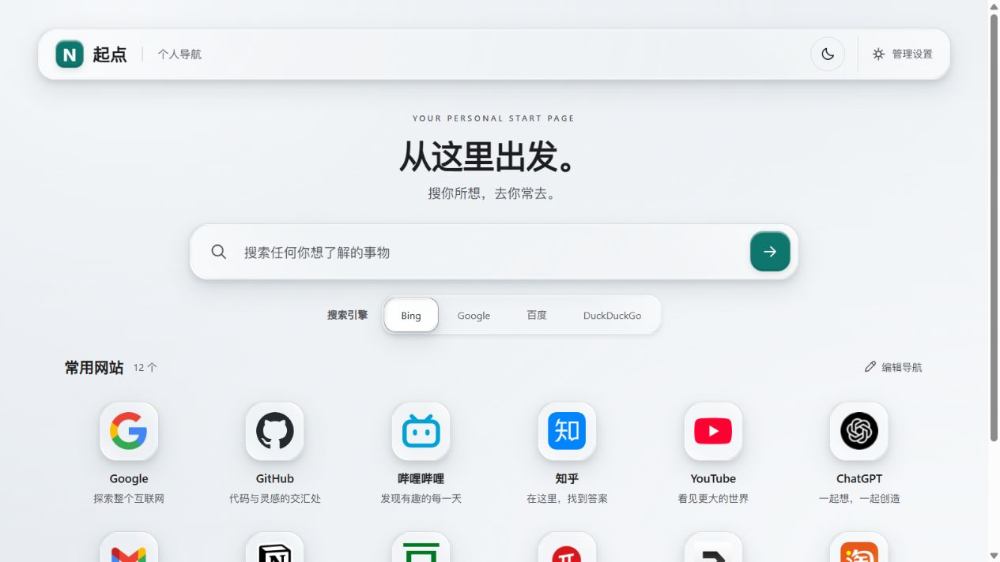
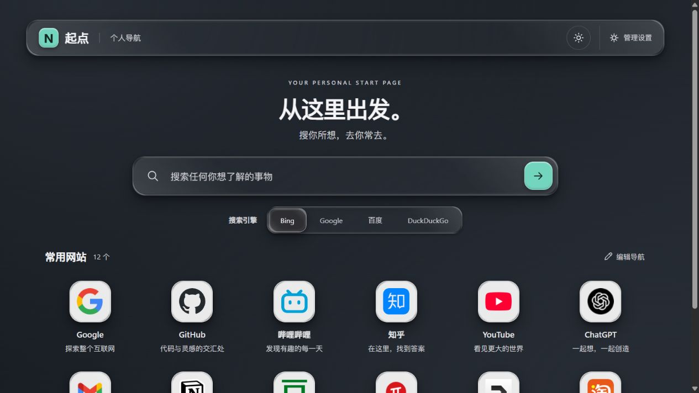
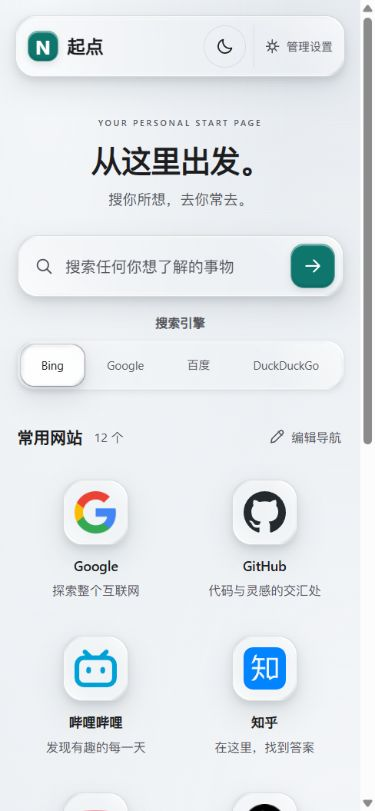
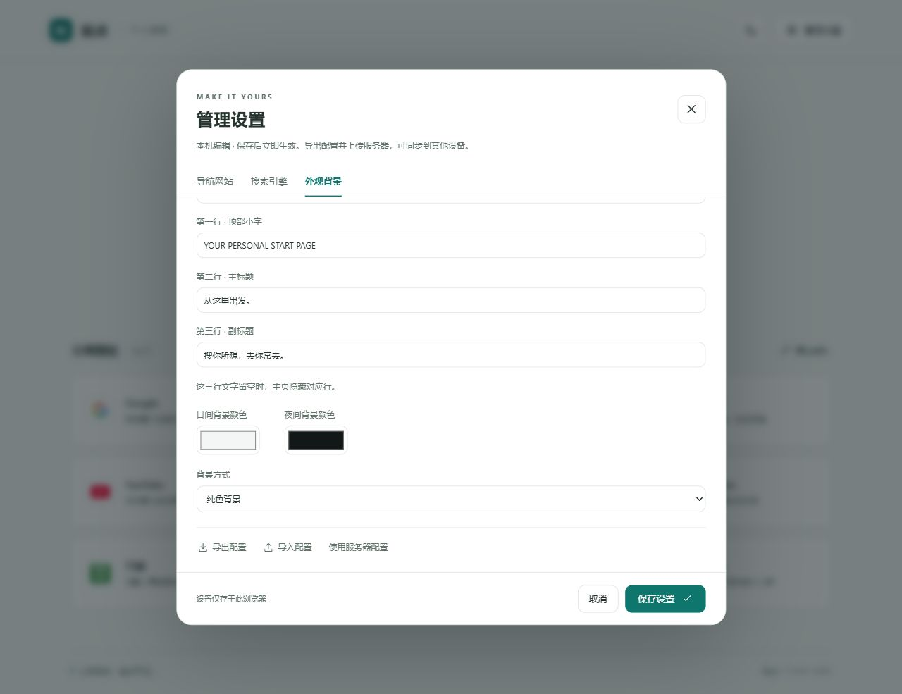

# 起点 · 个人导航

一个带液态玻璃材质的 Apple 风格个人起始页，把搜索和常用网站放在触手可及的位置。

使用 HTML、CSS 和原生 JavaScript，直接托管静态文件即可运行，无需构建、npm、数据库或后台进程。

## 页面预览

| 浅色主题 | 深色主题 |
| --- | --- |
|  |  |





## 功能

- **液态玻璃**：工具栏、搜索框、引擎滑块和网站图标底板使用半透明材质、低强度背景模糊、内描边及斜向高光；文字和图标独立绘制，保持清晰。支持浅色与深色主题，无额外依赖。
- **磁贴高光**：鼠标靠近网站图标时，纯白高光按距离逐渐亮起并跟随指针，离开后淡出；图标和文字保持稳定。触屏、减少动态效果或减少透明度模式不启用跟随高光。
- **搜索**：内置 Bing、Google、百度、DuckDuckGo，可添加自定义引擎。结果在新标签页打开，导航页继续保留。
- **滑块切换**：点击引擎时，选中底板滑动并轻微拉伸、回弹；快速连续切换从当前可见位置接续。切换立即生效，无需等待动画结束。
- **常用网站**：默认 12 个入口，名称、网址、图标、备用文字、描述和顺序均可编辑。
- **响应式布局**：桌面六列、平板三列、手机两列；浮动玻璃工具栏与 Spotlight 式搜索框使用统一的中性色和青绿点缀。
- **紧凑模式**：在「外观背景」中开启，缩短顶部和磁贴间距、隐藏网站描述，手机改为三列；默认关闭，旧配置保持原布局。
- **主题与背景**：首次跟随系统日夜偏好，手动切换后记住选择；可自定义两套背景色，或上传 JPG、PNG、WebP 图片。
- **文字定制**：可编辑导航名称、顶部小字、主标题和副标题，三行介绍分别留空即可隐藏；搜索引擎标签也可关闭。
- **本机设置与同步**：编辑、保存、导入和导出配置。已有本机配置及旧版服务器配置继续兼容。
- **键盘与动态偏好**：按钮可用键盘操作，设置标签支持方向键；键盘选择引擎及减少动态模式直接定位滑块。减少透明度模式及不支持背景模糊的浏览器使用实色表面。

## 快速开始

获取当前代码：

```bash
git clone https://github.com/NielaoGanBu/personal-navpage-qidian.git
cd personal-navpage-qidian
python3 -m http.server 8789 --bind 127.0.0.1
```

Windows 可将最后一行的 `python3` 换成 `python`。浏览器访问 [http://127.0.0.1:8789/](http://127.0.0.1:8789/)。

也可在 GitHub 选择 **Code → Download ZIP** 下载当前分支，解压后运行同一条预览命令。建议通过 HTTP 打开，避免 `file://` 下的浏览器存储差异。

## 自定义

点击右上角「管理设置」：

| 设置页 | 可以修改 |
| --- | --- |
| 导航网站 | 网站名称、地址、图标链接、备用文字、描述；添加、删除、撤销最近一次删除和调整顺序 |
| 搜索引擎 | 引擎名称、搜索地址、默认引擎，以及主页标签的显示 |
| 外观背景 | 导航名称、紧凑模式、三行介绍文字、日夜背景色和上传图片 |

搜索地址必须包含 `{q}`，例如：

```text
https://www.bing.com/search?q={q}
```

搜索时会将 `{q}` 替换成编码后的关键词。上传背景图片会缩小至最长边不超过 1920 像素，并压缩为 WebP 后保存。

### 保存和跨设备同步

「保存设置」只在当前浏览器生效。管理面板没有服务器管理员登录或服务端写入接口，其他访客的修改也只影响自己的浏览器。

如需把配置发布给其他设备：

1. 编辑后点击「导出配置」，下载 `config.js`；背景图片已包含在文件中。
2. 备份服务器原来的 `config.js`，通过 SFTP 或网站面板上传新文件并覆盖。
3. 在其他设备刷新页面。已保存本机设置的浏览器，刷新后再点击「使用服务器配置」，确认内容后点击「保存设置」，清除本机覆盖并加载服务器设置。

本机设置优先于服务器配置。「使用服务器配置」先将当前页面已经加载的服务器数据载入草稿，点击「保存设置」后才清除本机覆盖；关闭并放弃修改会保留原来的本机设置。如果在载入后继续编辑再保存，则保存为新的本机配置。上传新文件后应先刷新。清除站点数据会清除本机配置；域名、协议或端口变化也会使用独立的存储。

「导入配置」支持本站导出的 `.js` 或同结构 JSON，导入后还需点击「保存设置」。有未保存修改时，点击取消、关闭按钮、面板外部或按 Esc，会提示「继续编辑 / 放弃修改」；没有修改则直接关闭。删除网站后，可在面板底部撤销最近一次删除，继续编辑其他字段不会丢失这些编辑。导出配置会包含当前编辑内容。

### 网站图标

`icons/` 预存 23 个网站的品牌图标。默认入口及 GitHub、Google、YouTube、ChatGPT、Gmail、Notion 等使用本地资源，服务器不需要在运行时联网下载它们。部分图标使用高清 PNG 或 SVG，避免大尺寸图标模糊。

新增网站时，图标地址留空会优先按域名匹配本地图标，再尝试该网站的 `/favicon.ico`。支持子域名，以及 `twitter.com`、`discord.gg`、`t.me` 等别名。手动填写的图标链接优先；图片都加载失败时使用备用文字。外部 favicon 由访客浏览器读取。

图标来源见 [icons/sources.json](icons/sources.json)，许可范围见 [第三方资源说明](THIRD_PARTY_NOTICES.md)。

## 部署

将以下文件上传到静态网站根目录，保持相对路径：

```text
index.html
styles.css
liquid-glass.css
app.js
config.js
icons/
LICENSE
LICENSES/
THIRD_PARTY_NOTICES.md
```

整份 `icons/` 都应上传。使用现有网站面板、Nginx 或其他静态文件服务即可，无需执行构建命令。

更新已经部署的站点时，**保留自定义的 `config.js` 和用户资源**，更新 `index.html`、`styles.css`、`liquid-glass.css`、`app.js` 与 `icons/`，并保留随代码提供的许可文件。已有本机设置继续保留，旧版默认背景颜色不会被自动改写。

[Releases](https://github.com/NielaoGanBu/personal-navpage-qidian/releases) 可下载已发布部署包；要使用本次改版，请确认发布包包含这些更新，或直接使用当前 `main` 分支源码。

### Debian / Nginx 示例

已有 Nginx 或网站面板时优先沿用现有环境。以下步骤用于新增独立站点，执行前将示例域名换成自己的域名，完成 DNS 解析并允许 TCP 80：

```bash
sudo apt update
sudo apt install nginx
sudo mkdir -p /var/www/personal-nav
# 通过 SFTP 上传入口文件、两个 CSS、完整 icons/ 与许可说明
sudo find /var/www/personal-nav -type d -exec chmod 755 {} \;
sudo find /var/www/personal-nav -type f -exec chmod 644 {} \;
sudo cp nginx.conf /etc/nginx/sites-available/personal-nav
sudo nano /etc/nginx/sites-available/personal-nav
# 将 server_name 修改为自己的域名
sudo ln -s /etc/nginx/sites-available/personal-nav /etc/nginx/sites-enabled/personal-nav
sudo nginx -t
# 仅在配置检查通过后执行
sudo systemctl reload nginx
```

`nginx.conf` 是仓库中的示例，执行复制命令前应先将它上传到服务器工作目录；若站点链接已存在，无需重复创建。HTTPS 可沿用现有面板或反向代理的证书配置。示例配置为静态资源设置 `Cache-Control: no-cache`，让上传后的配置重新验证缓存。

用自己的域名核对首页和配置：

```bash
curl -I http://nav.example.com/
curl -I http://nav.example.com/config.js
```

两者应返回 `200`，再用浏览器实际完成搜索、网站跳转、设置保存和刷新。状态码单独不能证明完整功能正常。

修改已有站点前备份文件、站点配置与入口。回退时恢复备份，`nginx -t` 通过后再 reload；首次新增独立站点时只停用自己新增的站点链接，保留其他网站。

使用 DeepSeek Harness 部署时，可填写并使用 [配套部署提示词](docs/deploy-harness.md)。

## 玻璃材质与兼容性

材质实现参考 [greyd097/yzrt 的纯 CSS 液态玻璃示例](https://gitee.com/greyd097/yzrt/tree/master/)，使用提交 `2cae7d6a61d6a019a5c40bda05dc6a065ae7e246`。`liquid-glass.css` 适配其中的半透明底色、2px 背景模糊、多方向内阴影与高光，未使用全页对比度过滤、文字模糊或禁止选择文字。它是 CSS 光学近似，没有像素位移折射。

默认中性背景搭配玻璃材质；自定义背景颜色或图片时，原有的不透明文字面板继续保护可读性。深色模式降低高光强度，品牌图标保留浅色底板。系统开启「减少透明度」时所有玻璃表面使用实底；浏览器不支持 `backdrop-filter` 时也保留实底。

## 验证范围

2026-10-15 在本地 HTTP 服务中用 Chromium 验证整合版：

- 实际查看浅色、深色和 390 × 844 手机布局，确认 12 个网站图标正常加载、手机两列且无横向溢出。
- 实测引擎切换、滑块终点对齐、中文 Bing 搜索结果新标签页、设置保存后刷新持久化。
- 抽查玻璃背景颜色范围内的小字对比度，浅色最低 **6.08:1**、深色最低 **5.82:1**。计算使用默认背景颜色上下界，包含透明底色和完整高光，不包含边缘阴影像素，不能视为截图逐像素认证。原版管理面板截图与 2026-10-14 的 15 项功能、8 项动画验证记录保留为历史范围。

真实 iPhone / Safari 硬件和 Debian 线上部署未验证。示例网站在不同网络中的可达性取决于访客的网络环境。

## 许可证

原有网站代码及原创文档继续使用 [MIT License](LICENSE)。新增的 `liquid-glass.css` 派生自 greyd097/yzrt，以 [GPL-2.0](LICENSES/yzrt-GPL-2.0.txt) 提供，文件头保留来源、提交与修改日期；包含该派生样式的整合版本按 GPL-2.0 条件整体分发；原独立 MIT 文件保留原授权和版权声明，不应将整个组合版本标为 MIT-only。分发时保留两份许可、归属说明及相应源码。

第三方平台的品牌图标仅用于标识对应网站，项目与这些平台没有隶属或背书关系，图标权利与许可不自动适用 MIT 或 GPL；详见 [第三方资源说明](THIRD_PARTY_NOTICES.md)。

## 开发验证

线上运行仍然只需要静态文件。修改设置逻辑时，可使用 Node.js 和开发依赖运行浏览器回归检查：

```bash
pnpm install --frozen-lockfile
pnpm exec playwright install chromium
pnpm test
```

已有 Google Chrome 时，也可使用 `PLAYWRIGHT_CHANNEL=chrome pnpm test`，无需另外下载 Chromium。测试会启动临时本机 HTTP 服务及独立浏览器上下文，不读取日常浏览器配置。覆盖服务器配置草稿、保存与放弃、关闭方式、撤销删除、旧配置兼容、紧凑模式导入导出及手机布局。
